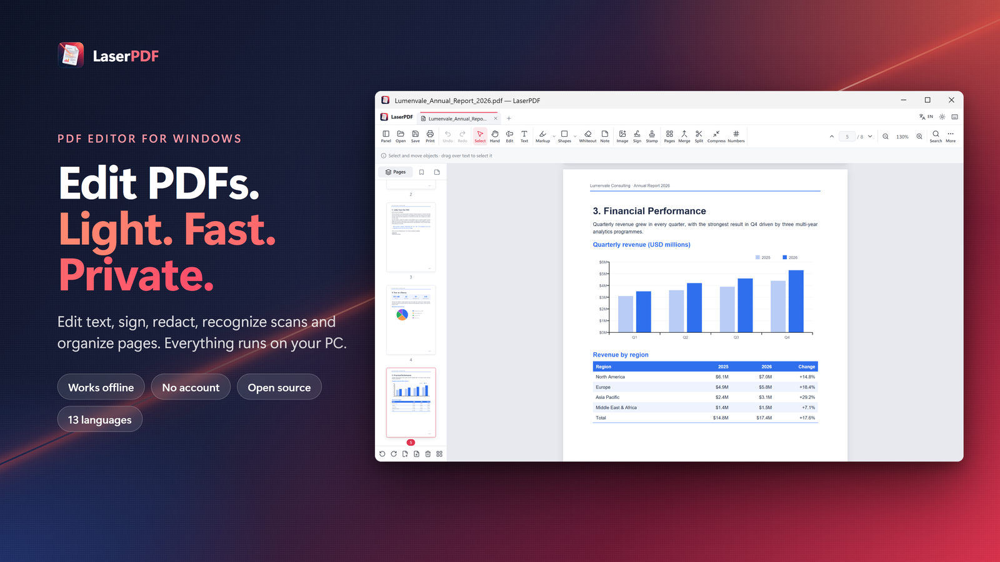
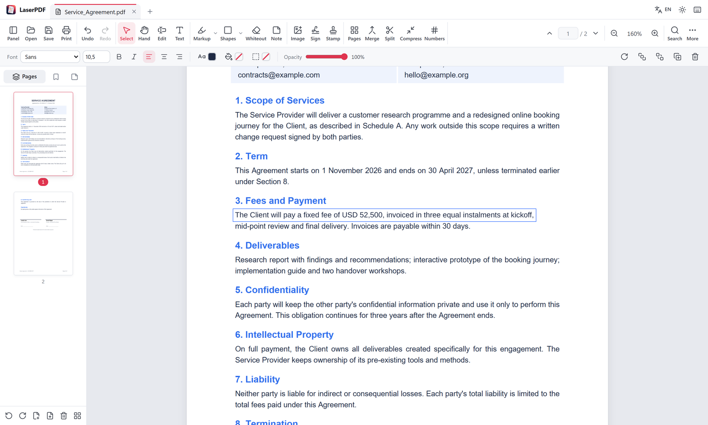
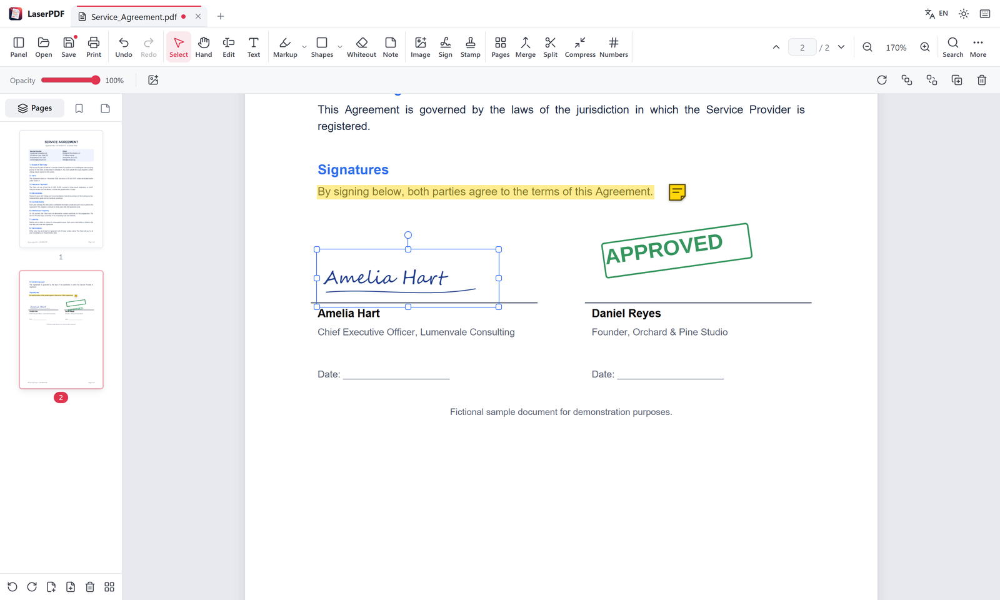
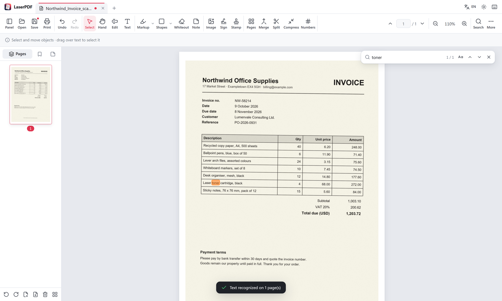
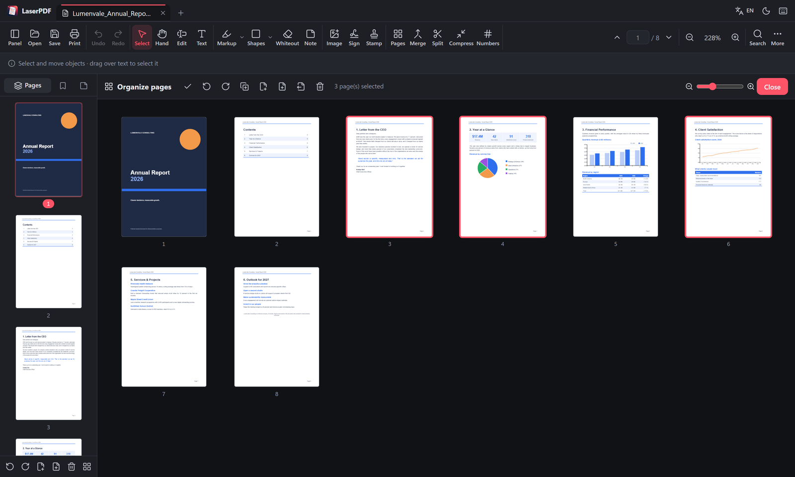

# LaserPDF

**English** · [Türkçe](README.tr.md)

A lightweight, fast **PDF viewer and editor for Windows**. It edits the text that is already in a PDF, signs, redacts, recognizes scanned pages and organizes pages, and everything runs on your PC: no account, no uploads, no tracking.

<a href="https://apps.microsoft.com/detail/9NWK3HL0L4KB"></a>



- **Small:** built with [Tauri](https://tauri.app), so it uses the web engine that ships with Windows (WebView2) instead of bundling a browser like Electron apps do. The Store package is about 38 MB, most of it fonts for Chinese, Japanese and Korean and the text recognition models.
- **Rendering:** [pdf.js](https://mozilla.github.io/pdf.js/) (Firefox's PDF engine). **Editing and saving:** [pdf-lib](https://pdf-lib.js.org/).
- **13 languages:** English, Turkish, German, Spanish, French, Italian, Polish, Portuguese (Brazil), Russian, Indonesian, Japanese, Korean and Chinese (Simplified). The system language is picked on first start. Light and dark themes.
- **Works with AI assistants:** a built-in [MCP server](#use-with-ai-assistants-mcp) lets Claude Desktop and other MCP clients work with your PDFs on your PC.

| Edit existing text | Sign and annotate |
|---|---|
|  |  |
| **Text recognition (OCR)** | **Organize pages (dark theme)** |
|  |  |

## Features

### Viewing
- Fast on-demand rendering: documents with hundreds of pages open instantly
- Zoom (Ctrl + wheel, fit width or page), page navigation, thumbnails and bookmarks panel
- Search (Turkish İ/ı aware), select and copy text
- Links (internal links jump to the page, external links open in the browser)
- Tabs for several documents, recent files, presentation mode (F5), night reading mode
- Opening another PDF while LaserPDF is running opens it in a new tab

### Editing
- **Edit existing text:** click a line and type. The old text is removed from the page and the new text is written in its place without damaging colored or patterned backgrounds. Size, color and bold/italic are kept; the font is replaced with the closest match (letter widths are identical for Arial/Helvetica, Times, Courier and Calibri).
- **Add text** with font, size, bold/italic, alignment, color, background and border
- **Images:** PNG, JPG, WebP, GIF, BMP, or paste from the clipboard (Ctrl+V)
- **Signatures:** draw, type your name or use an image; signatures are saved for next time
- **Stamps:** APPROVED, DRAFT, CONFIDENTIAL, date stamp or your own text
- **Markup:** highlight, underline and strike out text; pen and highlighter
- **Shapes:** rectangle, ellipse, line, arrow (color, fill, width, opacity)
- **Whiteout (redaction):** the text and links under the box are deleted from the file when you save. If something under it cannot be removed (an image, a scanned page, a form field), LaserPDF offers to turn that page into an image
- **Sticky notes** saved as real PDF note annotations
- **Form filling:** text fields, checkboxes and drop-down lists
- Every object can be moved, resized, rotated, duplicated, copied and pasted
- **Annotations** panel listing every comment page by page
- Undo / redo (150 steps)

### Pages
- Reorder pages by drag and drop, in the sidebar or the full-screen **Organize pages** view
- Rotate, delete, duplicate, insert blank pages
- Insert pages from other PDFs or images; drop files onto the sidebar
- Extract selected pages to a new PDF, split a document into files of N pages
- Flatten a page (turn it into an image for **permanent redaction**)

### Tools
- Merge PDFs, create a PDF from images, new blank document
- Page numbers, header/footer (e.g. `CONFIDENTIAL · Page {n} / {total}`) and watermarks
- Document properties (title, author, subject, keywords)
- **Remove hidden information** on save: creator program, dates, XMP data, comment authors and the location/camera data of photos. Location data of inserted photos is always removed
- **Text recognition (OCR):** recognizes scanned pages and adds an invisible text layer, so the text can be searched, selected and copied. English and Turkish, fully offline (Tesseract). Suggested when a scanned document is opened; scans below 150 dpi get an explanation instead of a long, failing run
- **Table to Excel:** draw a box around a table and save it as .xlsx. Ruled tables use the lines on the page, other tables the position of the text; amounts become numbers, codes and dates stay text. Scanned tables can be exported after text recognition
- Export a page as PNG/JPEG, reduce file size (by rasterizing scanned documents), print
- Open password-protected PDFs

## Install

- **Microsoft Store (recommended):** [LaserPDF](https://apps.microsoft.com/detail/9NWK3HL0L4KB). Updates are automatic.
- **Installer:** `LaserPDF_<version>_x64-setup.exe` or `.msi` on the [Releases](https://github.com/BatuhanCakmakk/laserpdf/releases) page. Release builds also include macOS (`.dmg`, unsigned: right-click → **Open** the first time) and Linux (`.deb`, `.AppImage`) packages, which get less testing than the Windows version.

### Build from source

Requirements: [Node.js 20+](https://nodejs.org), [Rust](https://rustup.rs) and the [Tauri prerequisites](https://tauri.app/start/prerequisites/).

```bash
npm install
npm run tauri dev      # desktop app in development mode
npm run tauri build    # installers in src-tauri/target/release/bundle
```

Tests (run the app in Chromium and check the saved PDFs):

```bash
npm test
```

Browser-only development server:

```bash
npm run dev            # http://localhost:1420
```

Every push to `main` builds the Windows installers and the Store package (**Actions → Build desktop apps → Artifacts**). Pushing a `v*` tag, or running the workflow with a `version`, builds all platforms and publishes a release. Update the version in `package.json`, `src-tauri/tauri.conf.json` and `src-tauri/Cargo.toml` first.

## Use with AI assistants (MCP)

Started with `--mcp`, LaserPDF runs as a [Model Context Protocol](https://modelcontextprotocol.io) server without opening a window. AI assistants that support MCP, such as Claude Desktop, can then work with PDFs on your PC. LaserPDF does the processing locally; nothing else (Node.js, Python) needs to be installed.

| Tool | What it does |
|---|---|
| `get_pdf_info` | Page count, size, title, author and other properties |
| `extract_text` | Text of all or selected pages |
| `search_pdf` | Find words or phrases, with page numbers |
| `recognize_text` | Recognize scanned pages (English and Turkish) and save a searchable PDF |
| `redact_pdf` | Black out or white out words and remove them from the file |
| `remove_metadata` | Remove author, programs, dates, XMP and photo location data |
| `merge_pdfs` | Join PDFs and images into one PDF |
| `extract_pages` | Save selected pages as a new PDF |
| `split_pdf` | Split a PDF into files of N pages |
| `rotate_pages` | Rotate all or selected pages |
| `add_page_numbers` | Page numbers or a header/footer such as `Page {n} of {total}` |
| `add_watermark` | A large, semi-transparent text such as CONFIDENTIAL across the pages |
| `compress_pdf` | Make scans and image-heavy PDFs smaller (pages become images) |
| `export_table` | Save a table from a page as .xlsx |

Tools that write files only write to the `output` path they are given and never overwrite an existing file unless `overwrite: true` is set.

`claude_desktop_config.json`:

```json
{
  "mcpServers": {
    "laserpdf": {
      "command": "laserpdf",
      "args": ["--mcp"]
    }
  }
}
```

`"command": "laserpdf"` works with the Microsoft Store version. If you used the installer, give the full path instead, e.g. `"C:\\Users\\<you>\\AppData\\Local\\LaserPDF\\laserpdf.exe"` (backslashes are doubled in JSON).

The [Dockerfile](Dockerfile) runs the Linux build as an MCP server in a container (with a virtual display), for MCP directories and clients that start servers that way.

## Privacy

LaserPDF works offline. It has no account, no ads, no analytics and makes no network requests; your files stay on your PC. When you connect it to an AI assistant over MCP, the assistant receives the results of the tools it calls, and what it does with them is governed by that assistant's own privacy terms.

## Keyboard shortcuts

| Shortcut | Action |
|---|---|
| Ctrl+O / Ctrl+S / Ctrl+Shift+S | Open / Save / Save as |
| Ctrl+P | Print |
| Ctrl+F | Search |
| Ctrl+Z / Ctrl+Y | Undo / Redo |
| Ctrl + / Ctrl − / Ctrl+0 | Zoom in / Zoom out / 100% |
| Ctrl+Tab, Ctrl+W | Switch tabs, close tab |
| F5 / Esc | Start / leave presentation mode |
| Space (hold) | Temporary hand tool |
| V H E T | Select, Hand, Edit text, Add text |
| M U K | Highlight, Underline, Strike out |
| P I | Pen, Highlighter |
| R O L A | Rectangle, Ellipse, Line, Arrow |
| W N | Whiteout, Note |
| Delete, Ctrl+D, Ctrl+C / Ctrl+V | Delete, duplicate, copy/paste the object |
| Arrow keys (×10 with Shift) | Nudge the selected object |

## Project structure

```
src/
  app.ts        UI: toolbar, tabs, menus, shortcuts
  viewer.ts     Page layout, on-demand rendering, zoom, form and link layers
  interact.ts   Selecting, moving, resizing and rotating objects; drawing tools
  objects.ts    On-screen rendering of annotation objects
  export.ts     Saving with pdf-lib (writes objects into the PDF content)
  erase.ts      Removes edited and redacted text from page content streams
  meta.ts       Hidden information removal, JPEG metadata stripping
  stream-iterator.ts  Stream iteration for WebKit webviews (Linux, macOS)
  ocr.ts        Text recognition (Tesseract) and the invisible text layer
  table.ts      Table detection and .xlsx writing
  mcp.ts        MCP tools (runs in a hidden window in --mcp mode)
  doc.ts        Document model, undo / redo history
  sidebar.ts    Thumbnails, page organizer, bookmarks
  search.ts     Search
  dialogs.ts    Signature, page numbers, watermark, properties and other dialogs
  platform.ts   Desktop (Tauri) and browser file access
src-tauri/      Rust side: window, file access, file associations, MCP stdio bridge
```

## Notes and limitations
- "Edit text" removes the old text from the page. Where it cannot (for example text inside a form XObject), the old text is covered and stays in the file. Whiteout always deletes the text under it; images cannot be cut, so pages with an image under a whiteout box are offered to be flattened when saving. You can also right-click any page and choose **Flatten (secure redaction)**.
- Encrypted PDFs can be opened; their pages are saved as images.
- Edited right-to-left text (Arabic, Hebrew) is not shaped yet.
- Added text uses the embedded Arimo, Tinos, Cousine, Carlito and Caladea fonts (same letter widths as Arial, Times New Roman, Courier New and Calibri; Caladea is close to Cambria). DejaVu covers other characters and Noto Sans covers Chinese, Japanese and Korean, so text looks right in every PDF reader.

## License
LaserPDF is licensed under the [GNU GPL v3.0](LICENSE) or (at your option) any later version.

Open source components: pdf.js (Apache-2.0), pdf-lib and @pdf-lib/fontkit (MIT), Tauri (MIT/Apache-2.0), Lucide icons (ISC), Arimo, Tinos and Cousine fonts (SIL Open Font License 1.1, `public/fonts/LICENSE-Arimo-Tinos-Cousine.txt`), Carlito and Caladea fonts (SIL Open Font License 1.1, `public/fonts/LICENSE-Carlito-Caladea.txt`), DejaVu fonts (Bitstream Vera license, `public/fonts/LICENSE-DejaVu.txt`), Noto Sans JP/SC/KR fonts (SIL Open Font License 1.1, `public/fonts/LICENSE-Noto.txt`), HarfBuzz (MIT), fflate (MIT), Tesseract, tesseract.js and the Tesseract language models (Apache-2.0, `public/tesseract/LICENSE-Tesseract.txt`).
