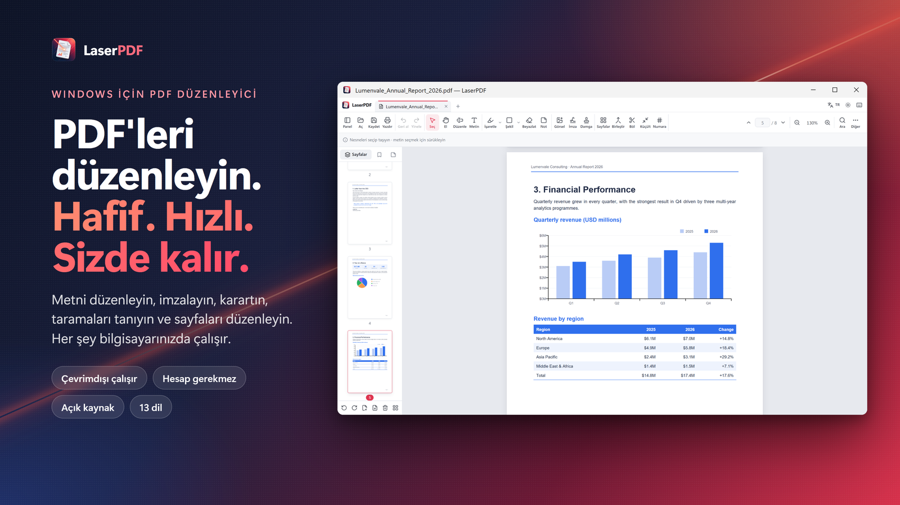
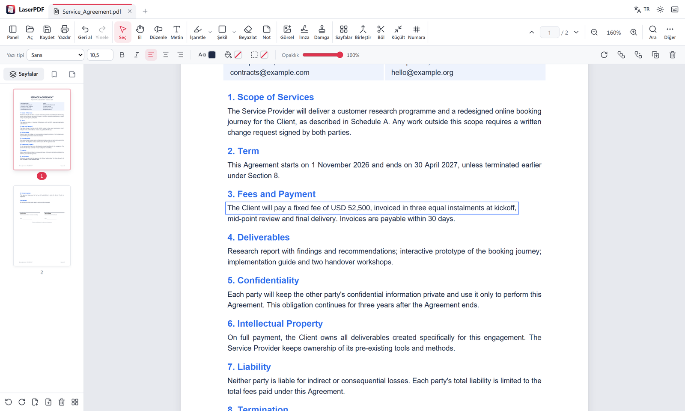
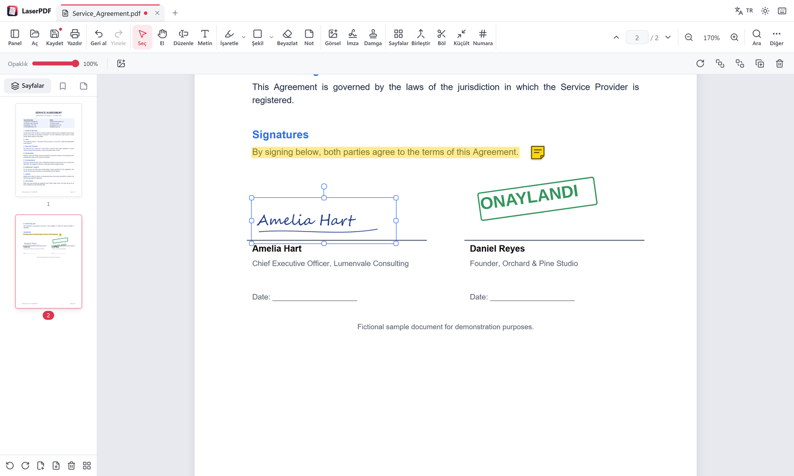
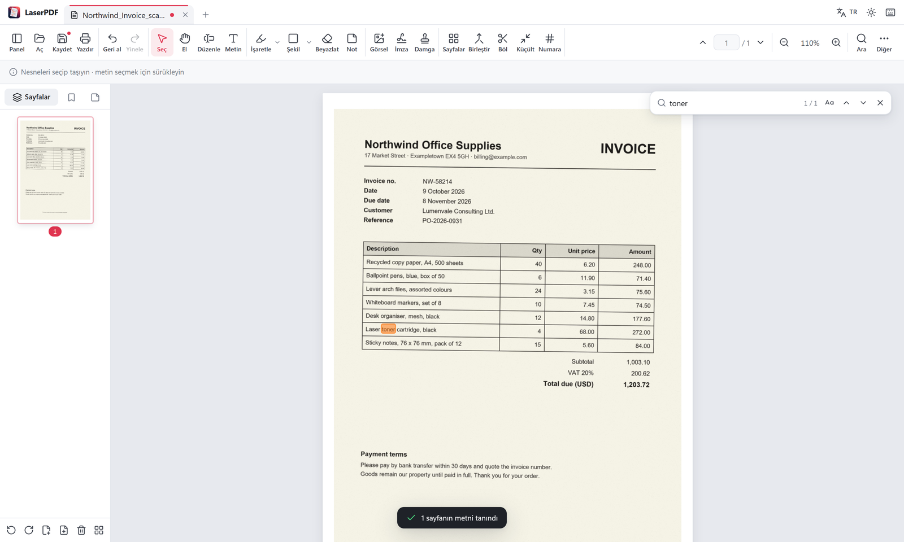
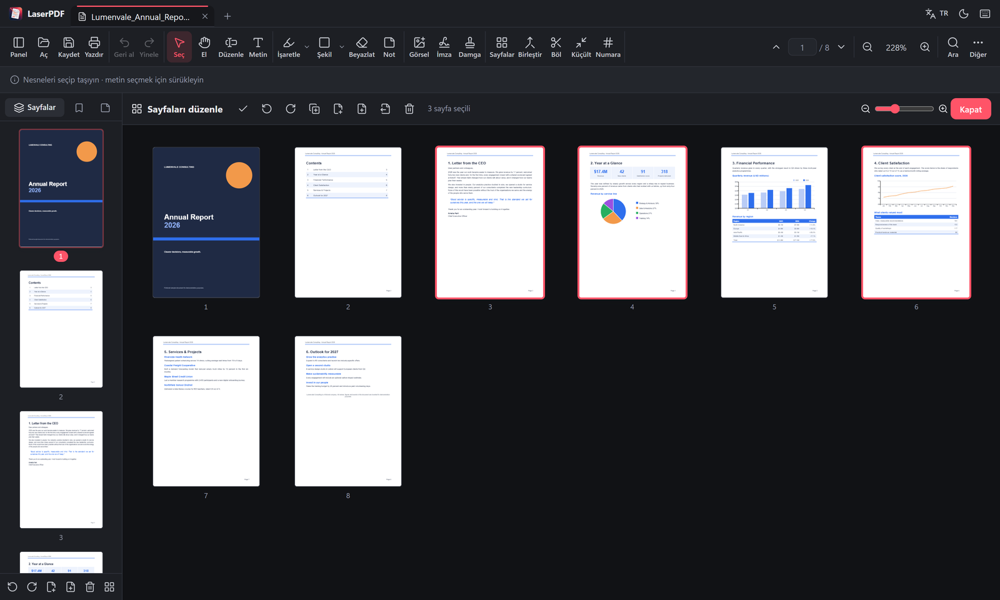

# LaserPDF

[English](README.md) · **Türkçe**

Windows için hafif ve hızlı bir **PDF görüntüleyici ve düzenleyici**. PDF'teki mevcut metni düzenler, imzalar, karartır, taranmış sayfaları tanır ve sayfaları düzenler. Her şey bilgisayarınızda çalışır: hesap yok, yükleme yok, izleme yok.

<a href="https://apps.microsoft.com/detail/9NWK3HL0L4KB"></a>



- **Küçük:** [Tauri](https://tauri.app) ile yapıldı. Electron uygulamaları gibi tarayıcıyı içinde taşımaz, Windows'un kendi web motorunu (WebView2) kullanır. Store paketi yaklaşık 38 MB; bunun çoğu Çince, Japonca ve Korece yazı tipleri ile metin tanıma modelleri.
- **Render:** [pdf.js](https://mozilla.github.io/pdf.js/) (Firefox'un PDF motoru). **Düzenleme ve kaydetme:** [pdf-lib](https://pdf-lib.js.org/).
- **13 dil:** Türkçe, İngilizce, Almanca, İspanyolca, Fransızca, İtalyanca, Lehçe, Portekizce (Brezilya), Rusça, Endonezce, Japonca, Korece ve Çince (Basitleştirilmiş). İlk açılışta sistem dili seçilir. Açık ve koyu tema.
- **Yapay zekâ asistanlarıyla çalışır:** Yerleşik [MCP sunucusu](#yapay-zekâ-asistanlarıyla-kullanım-mcp) sayesinde Claude Desktop ve diğer MCP istemcileri PDF'lerinizi bilgisayarınızda işleyebilir.

| Mevcut metni düzenleme | İmza ve notlar |
|---|---|
|  |  |
| **Metin tanıma (OCR)** | **Sayfaları düzenleme (koyu tema)** |
|  |  |

## Özellikler

### Görüntüleme
- Hızlı, ihtiyaç anında render (yüzlerce sayfalık belgeler anında açılır)
- Yakınlaştırma (Ctrl + tekerlek, genişliğe veya sayfaya sığdır), sayfa gezintisi, küçük resimler ve yer imleri paneli
- Belgede arama (Türkçe İ/ı duyarlı), metin seçme ve kopyalama
- Bağlantılar (iç bağlantılar sayfaya gider, dış bağlantılar tarayıcıda açılır)
- Birden çok belge için sekmeler, son açılan dosyalar, sunum modu (F5)
- Okuma modu (Ctrl+H): yalnızca sayfalar ve küçük bir çubuk, rahat okunan sayfa genişliği, normal, sepya veya gece sayfa tonu, tam ekran
- Uygulama açıkken başka bir PDF açıldığında yeni sekmede açılır

### Düzenleme
- **Mevcut metni düzenleme:** Metne tıklayın, yazın. Eski metin sayfadan silinir, yeni metin aynı yere yazılır; renkli ya da desenli arka plan bozulmaz. Boyut, renk ve kalın/italik korunur; yazı tipi en yakın eşdeğerle değiştirilir (Arial/Helvetica, Times, Courier ve Calibri için harf genişlikleri birebir aynıdır).
- **Metin ekleme:** yazı tipi, boyut, kalın/italik, hizalama, renk, arka plan ve çerçeve
- **Görsel ekleme:** PNG, JPG, WebP, GIF, BMP; panodan yapıştırma (Ctrl+V)
- **İmza:** çizin, adınızı yazın ya da görsel yükleyin; imzalar sonraki kullanım için kaydedilir
- **Damgalar:** ONAYLANDI, TASLAK, GİZLİDİR, tarih ya da tarih ve saat, özel metin veya adınızla birlikte tarih ve saat içeren damga
- **İşaretleme:** vurgulama, altını çizme, üstünü çizme; kalem ve fosforlu kalem
- **Şekiller:** dikdörtgen, elips, çizgi, ok (renk, dolgu, kalınlık, opaklık)
- **Karartma:** Siyah veya beyaz bir kutu çizin; altındaki metin ve bağlantılar kaydederken dosyadan da silinir. Altında silinemeyen bir içerik varsa (görsel, taranmış sayfa, form alanı) o sayfayı görüntüye çevirmeyi önerir
- **Bağlantılar:** Bir web adresini açan ya da belgedeki bir sayfaya giden alan çizin
- **Yapışkan notlar:** PDF'e gerçek not açıklaması olarak kaydedilir
- **Form doldurma:** metin alanları, onay kutuları, açılır listeler
- Her nesne taşınabilir, boyutlandırılabilir, döndürülebilir, çoğaltılabilir, kopyalanıp yapıştırılabilir
- Tüm açıklamaları sayfa sayfa listeleyen **Açıklamalar** paneli
- Geri al / yinele (150 adım); tüm değişiklikler geri alınınca kaydedilecek bir şey kalmaz
- **Kurtarma:** Kaydedilmemiş çalışma 30 saniyede bir saklanır; LaserPDF beklenmedik şekilde kapanırsa bir sonraki açılışta geri getirilebilir

### Sayfa işlemleri
- Sürükle-bırak ile yeniden sıralama (kenar çubuğu veya tam ekran **Sayfaları düzenle** görünümü)
- Döndürme, silme, çoğaltma, boş sayfa ekleme
- Başka PDF'lerden veya görsellerden sayfa ekleme; dosyaları kenar çubuğuna sürükleyip bırakma
- Seçili sayfaları ayrı PDF olarak ayıklama, belgeyi N sayfalık dosyalara bölme
- **Kırpma:** Sayfaları seçilen alana kırpma (bu sayfa, tüm sayfalar ya da seçili sayfalar); dışarıda kalan içerik silinmez, gizlenir
- **Yer imleri:** ekleme, yeniden adlandırma, sıralama, iç içe yerleştirme ve silme
- Sayfayı düzleştirme (görüntüye çevirerek **kalıcı karartma**)

### Araçlar
- PDF birleştirme, görsellerden PDF oluşturma, yeni boş belge
- Sayfa numarası, üst/alt bilgi (örn. `GİZLİ · Sayfa {n} / {total}`) ve filigran
- **Kitapçık:** Kâğıdın her yüzüne katlama sırasına göre iki sayfa; çift taraflı yazdırmak için (Geri al ile sayfalar geri gelir)
- Belge özellikleri (başlık, yazar, konu, anahtar kelimeler)
- Kaydederken **gizli bilgileri silme:** oluşturan program, tarihler, XMP verileri, yorum yazarları ve fotoğraflardaki konum/kamera bilgisi. Eklenen fotoğrafların konum bilgisi her zaman silinir
- **Metin tanıma (OCR):** Taranmış sayfaların metnini tanır ve sayfaya görünmez bir metin katmanı ekler; metin aranabilir, seçilebilir ve kopyalanabilir olur. Türkçe ve İngilizce, tamamen çevrimdışı (Tesseract). Taranmış bir belge açıldığında önerilir; 150 dpi altındaki taramalarda dakikalarca uğraşmak yerine nedenini söyler
- **Tabloyu Excel'e aktarma:** Tablonun çevresine alan çizip .xlsx olarak kaydedin. Çizgili tablolarda hücreler sayfadaki çizgilerden, çizgisiz tablolarda metnin konumundan bulunur; tutarlar sayıya çevrilir, kodlar ve tarihler metin kalır. Taranmış tablolar metin tanımadan sonra aktarılabilir
- Sayfayı PNG/JPEG olarak dışa aktarma, boyut küçültme (taranmış belgeleri görüntüye dönüştürerek), yazdırma
- Parola korumalı PDF'leri açma

## Kurulum

- **Microsoft Store (önerilen):** [LaserPDF](https://apps.microsoft.com/detail/9NWK3HL0L4KB). Güncellemeler otomatik gelir.
- **Kurulum dosyası:** [Releases](https://github.com/BatuhanCakmakk/laserpdf/releases) sayfasında `LaserPDF_<sürüm>_x64-setup.exe` veya `.msi`. Sürümlerde macOS (`.dmg`, imzasız: ilk açılışta sağ tık → **Aç**) ve Linux (`.deb`, `.AppImage`) paketleri de bulunur; bunlar Windows sürümü kadar test edilmez.

### Kaynaktan derleme

Gereksinimler: [Node.js 20+](https://nodejs.org), [Rust](https://rustup.rs) ve [Tauri ön koşulları](https://tauri.app/start/prerequisites/).

```bash
npm install
npm run tauri dev      # geliştirme modunda masaüstü uygulaması
npm run tauri build    # kurulum dosyaları: src-tauri/target/release/bundle
```

Testler (uygulamayı Chromium'da çalıştırıp kaydedilen PDF'leri doğrular):

```bash
npm test
```

Yalnızca tarayıcıda geliştirme:

```bash
npm run dev            # http://localhost:1420
```

`main` dalına her push Windows kurulum dosyalarını ve Store paketini üretir (**Actions → Build desktop apps → Artifacts**); yalnızca belgelerdeki (`*.md`, `docs/`) değişiklikler derlenmez. `v*` etiketi push'lamak ya da iş akışını `version` ile çalıştırmak tüm platformları derler ve sürümü yayınlar. Önce `package.json`, `package-lock.json`, `src-tauri/tauri.conf.json`, `src-tauri/Cargo.toml`, `src-tauri/Cargo.lock`, `src/app.ts` ve `Dockerfile` içindeki sürüm numarasını güncelleyin.

## Yapay zekâ asistanlarıyla kullanım (MCP)

LaserPDF, `--mcp` ile başlatıldığında pencere açmadan bir [Model Context Protocol](https://modelcontextprotocol.io) sunucusu olarak çalışır. Claude Desktop gibi MCP destekleyen asistanlar PDF'leri bilgisayarınızda işleyebilir; işlemleri LaserPDF yerel olarak yapar. Ayrı bir program (Node.js, Python) gerekmez.

<a href="https://glama.ai/mcp/servers/BatuhanCakmakk/laserpdf"></a>

| Araç | Ne yapar |
|---|---|
| `get_pdf_info` | Sayfa sayısı, boyut, başlık, yazar ve diğer özellikler |
| `extract_text` | Tüm sayfaların veya seçili sayfaların metni |
| `search_pdf` | Kelime veya ifade arama, sayfa numaralarıyla |
| `recognize_text` | Taranmış sayfaları tanıyıp aranabilir PDF kaydetme (Türkçe ve İngilizce) |
| `redact_pdf` | Kelimeleri siyah veya beyaz kutuyla karartıp dosyadan silme |
| `remove_metadata` | Yazar, program, tarih, XMP ve fotoğraf konum bilgilerini silme |
| `merge_pdfs` | PDF'leri ve görselleri tek PDF'te birleştirme |
| `extract_pages` | Seçili sayfaları yeni PDF olarak kaydetme |
| `split_pdf` | PDF'i N sayfalık dosyalara bölme |
| `rotate_pages` | Tüm veya seçili sayfaları döndürme |
| `add_page_numbers` | Sayfa numarası ya da `Sayfa {n} / {total}` gibi üst/alt bilgi |
| `add_watermark` | Sayfalara GİZLİ gibi büyük, yarı saydam bir yazı |
| `compress_pdf` | Taranmış ve görsel ağırlıklı PDF'leri küçültme (sayfalar görüntüye çevrilir) |
| `pdf_to_images` | Sayfaları PNG veya JPEG görüntü olarak kaydetme |
| `export_table` | Sayfadaki bir tabloyu .xlsx olarak kaydetme |

Dosya yazan araçlar yalnızca verilen `output` yoluna yazar ve var olan bir dosyanın üzerine `overwrite: true` olmadan yazmaz.

Boştaki sunucu neredeyse hiç kaynak kullanmaz: PDF motoru (gizli pencere) ilk araç çağrısında açılır ve 5 dakika araç çağrılmazsa kapanır. Böylece her sohbette LaserPDF'i başlatan bir asistan onu sürekli çalışır tutmaz.

`claude_desktop_config.json`:

```json
{
  "mcpServers": {
    "laserpdf": {
      "command": "laserpdf",
      "args": ["--mcp"]
    }
  }
}
```

`"command": "laserpdf"` Microsoft Store sürümünde çalışır. Kurulum dosyasıyla kurduysanız tam yolu yazın, ör. `"C:\\Users\\<ad>\\AppData\\Local\\LaserPDF\\laserpdf.exe"` (JSON'da ters eğik çizgiler çift yazılır).

[Dockerfile](Dockerfile), Linux sürümünü bir kapsayıcıda (sanal ekranla) MCP sunucusu olarak çalıştırır; sunucuları bu şekilde başlatan MCP dizinleri ve istemcileri içindir.

## Gizlilik

LaserPDF çevrimdışı çalışır. Hesap, reklam ve analitik yoktur, ağ isteği yapmaz; dosyalarınız bilgisayarınızda kalır. MCP ile bir yapay zekâ asistanına bağladığınızda asistan, çağırdığı araçların sonuçlarını alır; bunları nasıl kullandığı o asistanın gizlilik koşullarına bağlıdır.

## Klavye kısayolları

| Kısayol | İşlev |
|---|---|
| Ctrl+O / Ctrl+S / Ctrl+Shift+S | Aç / Kaydet / Farklı kaydet |
| Ctrl+P | Yazdır |
| Ctrl+F | Ara |
| Ctrl+Z / Ctrl+Y | Geri al / Yinele |
| Ctrl + / Ctrl − / Ctrl+0 | Yakınlaştır / Uzaklaştır / %100 |
| Ctrl+Tab, Ctrl+W | Sekmeler arası geçiş, sekmeyi kapat |
| Ctrl+H / Esc | Okuma moduna gir / çık |
| F5 / Esc | Sunum moduna gir / çık |
| Boşluk (basılı tut) | Geçici el aracı |
| V H E T | Seç, El, Metni düzenle, Metin ekle |
| M U K | Vurgula, Altını çiz, Üstünü çiz |
| P I | Kalem, Fosforlu kalem |
| R O L A | Dikdörtgen, Elips, Çizgi, Ok |
| W N | Karartma, Not |
| Delete, Ctrl+D, Ctrl+C / Ctrl+V | Nesneyi sil, çoğalt, kopyala/yapıştır |
| Ok tuşları (Shift ile ×10) | Seçili nesneyi kaydır |

Proje yapısı, sınırlamalar ve lisanslar için [İngilizce README](README.md#project-structure)'ye bakın.

## Proje yapısı

```
src/
  app.ts        Arayüz: araç çubuğu, sekmeler, menüler, kısayollar
  viewer.ts     Sayfa yerleşimi, ihtiyaç anında render, yakınlaştırma, form ve bağlantı katmanları
  interact.ts   Nesneleri seçme, taşıma, boyutlandırma ve döndürme; çizim araçları
  objects.ts    Açıklama nesnelerinin ekranda çizilmesi
  export.ts     pdf-lib ile kaydetme (nesneleri PDF içeriğine yazar)
  erase.ts      Düzenlenen ve karartılan metni sayfa içeriğinden siler
  meta.ts       Gizli bilgileri silme, JPEG meta verisini temizleme
  stream-iterator.ts  WebKit web görünümleri (Linux, macOS) için akış yinelemesi
  ocr.ts        Metin tanıma (Tesseract) ve görünmez metin katmanı
  table.ts      Tablo bulma ve .xlsx yazma
  mcp.ts        MCP araçları (--mcp modunda gizli bir pencerede çalışır)
  doc.ts        Belge modeli, geri al / yinele geçmişi
  sidebar.ts    Küçük resimler, sayfa düzenleyici, yer imleri
  search.ts     Arama
  dialogs.ts    İmza, sayfa numarası, filigran, özellikler ve diğer pencereler
  platform.ts   Masaüstü (Tauri) ve tarayıcı dosya erişimi
  recovery.ts   Kaydedilmemiş çalışmanın otomatik saklanması ve çökmeden sonra kurtarma
src-tauri/      Rust tarafı: pencere, dosya erişimi, dosya ilişkilendirmeleri, MCP stdio köprüsü
```

## Notlar ve sınırlamalar
- "Metni düzenle" eski metni sayfadan siler. Silemediği yerlerde (örneğin form XObject içindeki metin) eski metnin üstü örtülür ve metin dosyada kalır. Karartma altındaki metni her zaman siler; görseller kesilemediği için altında görsel olan karartma kutularının bulunduğu sayfaları kaydederken düzleştirmeyi önerir. Herhangi bir sayfaya sağ tıklayıp **Düzleştir (güvenli karartma)** da seçebilirsiniz.
- Şifreli PDF'ler açılabilir; sayfaları görüntü olarak kaydedilir.
- Düzenlenen sağdan sola metin (Arapça, İbranice) henüz doğru şekillendirilmiyor.
- Eklenen metin gömülü Arimo, Tinos, Cousine, Carlito ve Caladea yazı tiplerini kullanır (Arial, Times New Roman, Courier New ve Calibri ile aynı harf genişlikleri; Caladea, Cambria'ya yakındır). Diğer karakterleri DejaVu, Çince, Japonca ve Korece'yi Noto Sans karşılar; böylece metin her PDF okuyucuda doğru görünür.

## Lisans
LaserPDF, [GNU GPL v3.0](LICENSE) ya da (tercihinize göre) daha sonraki bir sürümüyle lisanslanmıştır.
